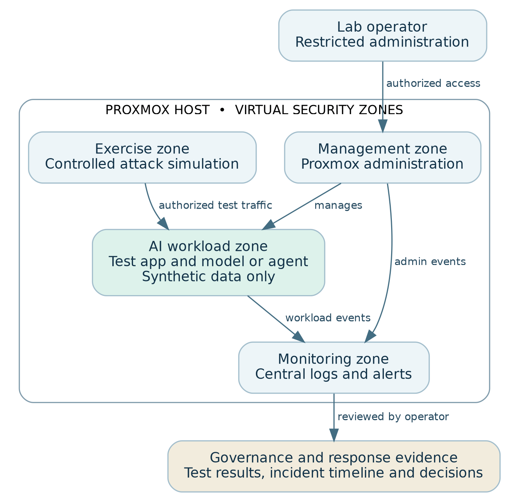

[← Back to portfolio](../index.html#portfolio)

# Enterprise AI Governance and Cybersecurity Lab

**Role:** Founder and designer
**Status:** Active build. First validation run passed, November 2026
**Frameworks:** NIST AI RMF, ISO/IEC 42001, Zero Trust

📄 **[Download the full case study (PDF)](../documents/Sibley-Enterprise-AI-Lab-Case-Study.pdf)**

---

## 1. The problem
I designed this lab to answer a question I would bring to any AI investment decision: **what evidence shows that a team can deploy, monitor and recover an AI service within its approved risk limits?** AI governance policies are only useful if the controls behind them actually work. This lab turns governance requirements such as human oversight, data boundaries and incident recovery into tests with clear pass criteria and captured evidence. Every exercise uses synthetic data only.

## 2. My approach
The platform is a single Proxmox VE host (Ryzen 9 7900X, 64 GB RAM, RTX 4070 SUPER, 2 TB NVMe) with an Ubuntu Server template for repeatable builds. The design separates administration, AI workloads, security exercises and monitoring, with default-deny rules between zones. The AI workload has no approved path to the management interface, and monitoring receives events so an operator can investigate and preserve evidence.

**Release decisions.** An AI risk register connects each use case to an accountable owner, a required control and the evidence needed for approval. If a required control fails, the owner documents remediation and submits fresh evidence before the next decision.

**Phased delivery.** Each phase must produce evidence the next phase can rely on:

1. **Foundation:** template-based hosts, ZFS storage and backup, verified restore
2. **Identity and segmentation:** Active Directory, endpoint policy, pfSense and VLANs
3. **Security monitoring:** Wazuh, endpoint logs, Suricata or Zeek
4. **Incident response:** TheHive and Velociraptor
5. **Local AI controls:** Ollama and Open WebUI over approved test documents
6. **Delivery and governance:** infrastructure automation and a risk register mapped to NIST AI RMF and ISO/IEC 42001

## 3. What I produced
- [Full case study (PDF)](../documents/Sibley-Enterprise-AI-Lab-Case-Study.pdf): architecture, release-decision model, phased roadmap and two reproducible test cases
- Test evidence: audit logs, receiver logs, firewall denial log and incident timeline *(screenshots to be added)*

## 4. Result: first validation run, November 2026

| Test | Pass criteria | Observed result |
|---|---|---|
| **01. Human approval for a sensitive AI action** | 0 deliveries before approval, 1 after approval, 0 for a rejected request; audit log links each request to reviewer, decision and timestamp | ✅ **Pass.** 0 deliveries while pending, exactly 1 after a reviewer approved, 0 for the separate rejected request |
| **02. Workload isolation and incident response** | 0 deliveries to the unapproved receiver; firewall logs the denial; operator traces and contains the event; approved workflow succeeds after recovery | ✅ **Pass.** Firewall blocked the transfer, 0 deliveries to the unapproved receiver; denial traced in monitoring, workload isolated, evidence preserved; approved workflow succeeded after restoring the known-good configuration |

## 5. What this shows about me
This is how I approach AI governance as a director: define the control, decide what evidence proves it works, test it, and only then expand. It's the same discipline behind the evidence gates in my [AI Strategy Brief](ai-strategy-brief.html), applied here to real systems.

---
*Last updated: November 2026*
