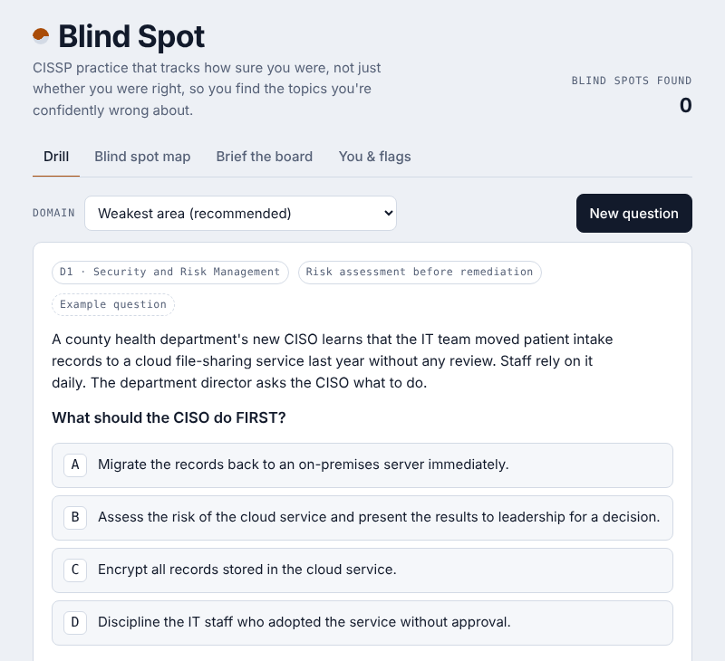

[← Back to portfolio](../index.html#portfolio)

# Blind Spot CISSP: An AI Study Coach That Finds Confident Mistakes

**Role:** Product owner and designer. I set the requirements and governance rules, and Claude wrote the code under my direction.
**Status:** Built, October 2026
**Built with:** Claude (Anthropic), aligned to the CISSP exam outline effective April 2024

🔗 **[Try the app](https://claude.ai/artifact/ALdKpekdWYvcRDnkjHCpoA)** (opening it requires a free Claude account)

---

## 1. The problem
Most practice tests only tell you whether you got a question right. The answers that hurt most on exam day are the ones you're *sure* about and still get wrong. They don't feel like weak spots, so you never study them. CISSP also tests whether you think like an executive advisor, which a multiple-choice score doesn't measure.

## 2. My approach
I designed the tool around three ideas:

- **Measure confidence, not just correctness.** Before locking in an answer, you rate how sure you are: guessing, leaning or sure. You can add a one-sentence reason, and Claude checks it. A right answer for the wrong reason still counts as a gap.
- **Show where you're confidently wrong.** A blind spot map compares accuracy with confidence for each CISSP domain, weighted by the 2024 exam percentages. "Weakest area" mode serves questions from your biggest gaps first, prioritizing the heaviest-weighted domains.
- **Practice the executive skill.** In "Brief the board," you answer a board member's question in under 150 words. Claude scores it for accuracy, plain language and business framing, points out jargon that would lose the room, and shows a stronger version.

It also tailors explanations with an analogy from your background (military, healthcare, finance, government and others), so concepts connect to work you already know.

## 3. Governing the AI inside it
Because AI writes every question, I built governance controls into the product itself:

- **Human feedback loop.** Every question has a flag button (wrong answer, unclear, outdated, other). Flags are collected into a report so errors can be reviewed and corrected.
- **Transparency.** The app tells users plainly that AI writes the questions and can be wrong.
- **Intellectual property.** All questions are original. None are reused from official or commercial question banks, and the app states that it isn't affiliated with or endorsed by ISC2.
- **Data minimization.** Progress is stored only in the user's own browser, with a one-click option to erase it.

## 4. Result
A working study tool I use for my own CISSP preparation, ready for other candidates to test. It's also my build project for the 2027 Claude Corps fellowship application.

## 5. What this shows about me
I can take an AI product from idea to working tool and govern it from the start: disclose what the AI does, give humans a way to catch its errors, respect intellectual property and collect only the data the product needs. Those are the same controls I'd require of any AI vendor.

---
*Last updated: November 2026*
