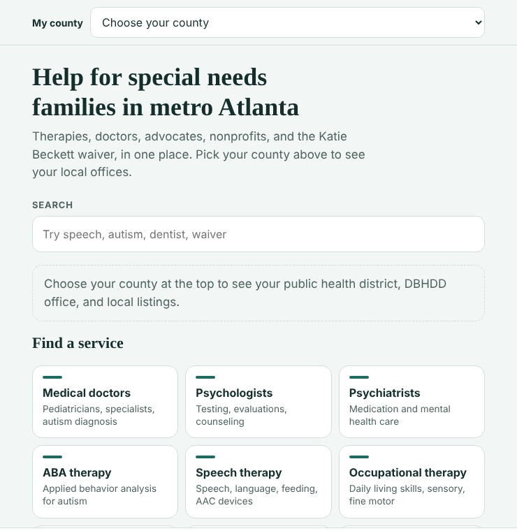

[← Back to portfolio](../index.html#portfolio)

# Georgia Special Needs Navigator

**Role:** Product owner and designer. I set the requirements, content rules and privacy design, and Claude wrote the code under my direction.
**Status:** Built, November 2026
**Built with:** Claude (Anthropic)

🔗 **[Try the app](https://claude.ai/artifact/Lzw5fuNqzYxt9GMcZVMQSE)** (opening it requires a free Claude account)

---

## 1. The problem
Families of children with disabilities in metro Atlanta often spend hours piecing together where to find therapists, doctors, advocates, nonprofits and state programs. Programs like Georgia's Katie Beckett waiver can provide Medicaid to a child with a disability regardless of parents' income, but many eligible families don't know it exists or how to apply. As a parent representative on my county's Exceptional Children's Services Parent Advisory Council, I hear this from families regularly.

## 2. My approach
I designed a single, mobile-friendly guide that puts the most important help in one place:

- **Six metro Atlanta counties:** Clayton, Coweta, DeKalb, Fayette, Fulton and Gwinnett. Choosing a county shows the local public health district, behavioral health office and local listings.
- **13 service categories,** including medical doctors, psychologists, psychiatrists, ABA, speech, occupational and music therapy, dentists, eye doctors, advocates, nonprofits, and waivers and state programs. Each category includes practical tips, such as which credential to look for.
- **35 curated resources,** labeled by type: organizations, provider finders and state programs.
- **A step-by-step Katie Beckett guide** covering who qualifies, which forms the doctor completes, how to apply and how to renew on time.
- **Crisis information on the home screen:** 911, 988 and the Georgia Crisis and Access Line.

## 3. Governing the content and data
Families make real decisions with this information, so I built in controls:

- **Reviewed before listed.** Families can suggest a therapist or program, but every suggestion is checked before it appears.
- **Free help first.** The guide points to free help before private consultants and tells families to ask about fees before hiring one.
- **Privacy by design.** The app asks for no names, diagnoses or account details. Saved resources stay on the family's own device.
- **Official sources.** Program steps link to Georgia Medicaid and Georgia Gateway, and the guide flags outdated mailing addresses that could delay an application.

## 4. Result
A working guide ready to share with families. I'm developing it as a community resource and as a portfolio project for my 2027 Claude Corps fellowship application.

## 5. What this shows about me
I can turn a real community need into a working AI-built product, and govern it responsibly: human review before content goes live, minimal data collection and clear sourcing for decisions that affect families. The same principles apply to any AI system that touches vulnerable people.

---
*Last updated: November 2026*
